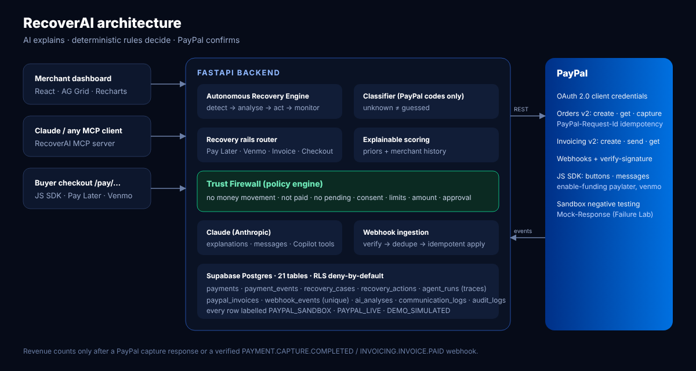

# RECOVERAI: the trusted AI agent that recovers failed PayPal payments

> **AI recommends. Rules decide. PayPal confirms.**
> Built for the PayPal AI Hackathon 2026.


RecoverAI is an autonomous recovery agent for PayPal merchants:

- It reads **PayPal's own failure signals**.
- It routes each lost sale to the **PayPal product most likely to win it back**: Pay Later, Venmo, a PayPal Invoice, or a fresh checkout.
- It proves every decision through a **Trust Firewall**.
- Revenue only counts once **PayPal confirms the payment**.

**Live demo:** `<https://recoverai-web.onrender.com>` · **Video:** `<YouTube>` · **Judge quick test:** Launch live demo → Mission Control → *Funding source declined* → Review & approve → open the link → pay as the sandbox buyer.

## Why it wins merchants back
| Problem | What RecoverAI does |
|---|---|
| ~70% of carts are abandoned ([Baymard, 50 studies](https://baymard.com/lists/cart-abandonment-rate)), and declined captures are revenue already earned | Detects failed, pending and abandoned payments, and opens one case per order |
| Merchants can't read `INSTRUMENT_DECLINED` / `PAYER_ACTION_REQUIRED` | Claude explains the failure in plain English. The category comes from PayPal's documented codes only, and "Unknown" is never guessed |
| A generic "you forgot something" email | **PayPal recovery rails**: Pay Later for a declined funding source, Venmo for US mobile buyers, a **PayPal Invoice** for high-value or repeat failures, or a fresh checkout |
| Fear of letting AI touch payments | **Trust Firewall**: 9 checks before every action, shown live. AI can't move money, can't double charge, and can't contact a buyer without consent |
| "Did it actually work?" | Revenue counts only on a PayPal capture response or a verified `PAYMENT.CAPTURE.COMPLETED` / `INVOICING.INVOICE.PAID` webhook |

## Highlights
- **Mission Control:** watch the agent's nine-step reasoning animate, with the PayPal rail it chose and every guardrail result.
- **Failure Lab:** one click creates a **real PayPal Sandbox order** and triggers a **genuine PayPal decline** using PayPal's official negative-testing header (`PayPal-Mock-Response`). The agent reacts to PayPal's own response, debug_id included.
- **Deep PayPal integration:**
  - OAuth with caching and refresh.
  - **Orders v2** create, get and capture with `PayPal-Request-Id`.
  - **Invoicing v2** create, send and get.
  - **Webhooks** with signature verification, de-duplication and idempotent processing.
  - **JS SDK** with `enable-funding=paylater,venmo` plus **Pay Later messages**.
- **Claude-powered:** explanations, three-tone messages, and a **tool-using Copilot** (10 tools over the merchant's own data). Every number comes from the database, never from the model.
- **Agentic anywhere:** an **MCP server** (`mcp_server/`) lets Claude Desktop or any MCP client rank, explain and draft recoveries, while approvals stay with the human.
- **Autonomy you control:** Automatic, Approval or Manual mode; sequential follow-ups; consent and message limits.
- **Merchant cockpit:**
  - AG Grid live payments.
  - Priority queue ranked by expected recoverable value.
  - Revenue Rescue Simulator with confidence ranges.
  - Analytics and CSV export.
  - Audit log.
- **Safe retry, never blind:** a capture timeout or PayPal 5xx marks the outcome *uncertain*. RecoverAI reconciles with PayPal first, then retries only a buyer-approved order with the **same idempotency key**. Retries are limited, rate-spaced and locked.
- **Failure Intelligence:** failure groups and trends, reason-code patterns, repeat failures, which recovery works per category, and evidence-backed insights.
- **Bring your own keys:** an encrypted credential vault for PayPal Sandbox/Live (kept strictly separate), Anthropic or any OpenAI-compatible model, Resend email and Twilio SMS (signed delivery callbacks). Includes an AI usage log, click tracking, quiet hours, an automation amount limit and allow-list, email verification, password reset, sign-out-everywhere, and a light/dark theme.
- **Honest data:** every row is labelled `PAYPAL_SANDBOX`, `PAYPAL_LIVE` or `DEMO_SIMULATED`, and the UI shows DEMO, SANDBOX and LIVE badges everywhere.



## Run it locally
**Full Windows/PowerShell walkthrough: [SETUP_GUIDE.md](SETUP_GUIDE.md).** Short version:
```powershell
# API (Python 3.12 recommended)
cd backend; python -m venv .venv; .\.venv\Scripts\Activate.ps1
pip install -r requirements.txt; Copy-Item .env.example .env   # set JWT_SECRET and SECRETS_KEY
python -m uvicorn app.main:app --reload --port 8000

# Dashboard (Node 20+), second window
cd frontend; npm install; npm run dev                             # http://localhost:5173
```
- Click **Explore the demo workspace**, or create your own account.
- Then open **Integrations** and paste your PayPal Sandbox keys, an AI key (**Google Gemini — free**, or Anthropic / OpenAI), and optionally Resend/Twilio. Secrets are encrypted at rest and never shown again.
- Without keys, everything runs in a clearly labelled demo mode. AI text is labelled *rules-based*, and messages are stored as *preview only*.

**Deploy:** Render → New → Blueprint → this repo (`render.yaml` creates the API and the static site). See [docs/DEPLOYMENT.md](docs/DEPLOYMENT.md).

**Tests:** `cd backend; python -m pytest -q` runs **75 tests**, covering:
- PayPal OAuth, orders, capture, invoicing, webhooks and negative testing, against a contract-faithful PayPal double.
- The credential vault.
- Safe retry and reconciliation.
- Idempotency, tenant isolation, roles and the Trust Firewall.
- The AI provider abstraction (Gemini, Anthropic, OpenAI).
- Auth flows.

In addition, 17 browser journeys were run with Playwright. What was and wasn't tested against real services is in [TESTING_REPORT.md](TESTING_REPORT.md).

## Repository
```
backend/      FastAPI app: PayPal client, agent, rails, Trust Firewall, webhooks, Failure Lab, Copilot, tests
frontend/     React + TS + Tailwind + AG Grid + PayPal JS SDK
mcp_server/   RecoverAI MCP server (Python MCP SDK 2.x)
supabase/     generated Postgres migration (24 tables, RLS on all)
docs/         PayPal setup, API, deployment, Devpost text, video script, checklist, screenshots
render.yaml   one-click deploy
```

## Docs
- **[SETUP_GUIDE.md](SETUP_GUIDE.md):** install, keys, environment variables, troubleshooting (Windows first)
- **[FEATURE_GUIDE.md](FEATURE_GUIDE.md):** every screen, and journeys to try
- **[TESTING_REPORT.md](TESTING_REPORT.md):** what was run, results, what needs your credentials
- **[ARCHITECTURE.md](ARCHITECTURE.md):** components, data model, safety model
- [PayPal setup](docs/PAYPAL_SETUP.md) · [API](docs/API.md) · [Deployment](docs/DEPLOYMENT.md) · [Video script](docs/VIDEO_SCRIPT.md) · [Devpost text](docs/DEVPOST.md) · [Submission checklist](docs/SUBMISSION_CHECKLIST.md)
  
